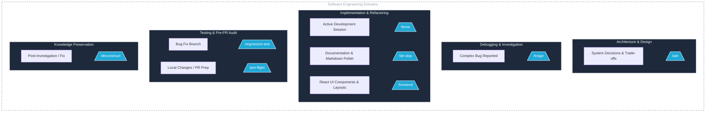

# ASS: Agentic Skill Set

A collection of high-precision, verification-focused `SKILL.md` specifications designed for **Claude Code** and **OpenCode**. 

Unlike generic prompts that jump straight to writing code, these skills enforce **diagnostic discipline**, **verification steps**, **blast-radius checks**, **code density**, **terse execution**, and **knowledge preservation**.

---

## Skill Overview

| Skill | Trigger / Command | Focus & Core Philosophy |
| :--- | :--- | :--- |
| **`deconstruct`** | `/deconstruct` `"write down how we figured this out"` | **Knowledge Capture.** Mines the active session to extract the diagnostic path, dead ends, and core breakthrough into a durable playbook rather than a simple commit fix. |
| **`triage`** | `/triage` `"debug this systematically"` | **Structured Isolation.** Enforces a diagnostic freeze before modifying application code. Uses zero-mutation checks to test falsifiable hypotheses. |
| **`pre-flight`** | `/pre-flight` `"audit these changes"` | **Blast-Radius Analysis.** Audits the boundary between your git diff and the rest of the codebase to catch broken invariants and unseen caller regressions. |
| **`regression-test`** | `/regression-test` `"write a test that proves this fix"` | **Red-to-Green Verification.** Proves a regression test by temporarily reverting the fix, verifying the test fails against the bug, and confirming it passes when applied. |
| **`adr`** | `/adr` `"document why we chose this architecture"` | **Decision Provenance.** Extracts lightweight Architecture Decision Records from chat history, emphasizing the negative space (what options were rejected and why). |
| **`de-slop`** | `/de-slop` `"clean up this prose/doc"` | **Document Refactoring.** Purges AI slop, structural fluff, meta-commentary, and passive abstract agency from markdown text and documents. |
| **`frontend`** | `/frontend` `"build a mobile-friendly React interface"` | **Frontend Guidance.** Uses DaisyUI components and Tailwind CSS layouts for consistent React interfaces, with attention to content hierarchy, responsive design, accessibility, and existing project conventions. |
| **`terse`** | `/terse [on \| off \| <task>]` `"switch to terse mode"` | **Execution Mode Control.** Toggles high-density, direct agent execution mode. Bypasses preambles, outputs atomic changes, and enforces concise terminal communication. |

---

## SDLC Toolkit Mapping

These skills act as modular power tools invoked at specific stages of the Software Development Life Cycle:

* **Architecture & Design:** Run `/adr` when trade-offs are decided during chat sessions to record architectural decision records before context is lost.
* **Debugging & Investigation:** Run `/triage` at the start of a complex incident to enforce a hypothesis-driven freeze before changing code.
* **Implementation & Refactoring:** Run `/frontend` when creating or updating React interfaces with DaisyUI and Tailwind CSS. Run `/terse` to activate minimal, zero-fluff agent behavior for fast execution loops[cite: 2], and run `/de-slop` on prose/documentation to strip AI-generated bloat.
* **Testing & Pre-PR Audit:** Run `/regression-test` to prove a fix using a strict Red-to-Green execution cycle, and run `/pre-flight` to audit blast-radius and consumer call sites outside the diff.
* **Knowledge Preservation:** Run `/deconstruct` at the end of a session to turn diagnostic steps and breakthroughs into reusable playbooks.

---

## License

Copyright (c) 2026 John Anthony Mariquit <john@mariquit.com>

This project is licensed under the MIT License. See the [LICENSE](./LICENSE) file for details.

## Contributing

Contributions are welcome! Please read our [CONTRIBUTING.md](./CONTRIBUTING.md) guide for details on skill-writing guidelines, validation, and the pull request process.
